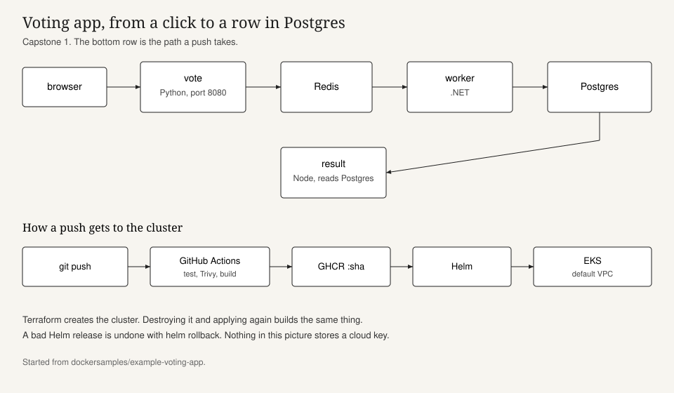

# Voting app

This is my fork of [dockersamples/example-voting-app](https://github.com/dockersamples/example-voting-app), pushed to [wsticks/voting-app](https://github.com/wsticks/voting-app). A vote goes into Redis, a worker writes it to Postgres, and the result page reads the totals back.

The work on top of the sample is: pin the images and run them as a normal user, stand the cluster up from Terraform, and let one push test, scan, build, and deploy. Helm is how I roll a bad release back.



## Run it on the laptop

Docker has to be running.

```bash
docker compose up --build
```

Vote on http://localhost:8080 and watch the count on http://localhost:8081.

I moved the app ports from 80 to 8080. A container that is not root cannot bind to 80, and the healthcheck was still calling port 80, so both had to change together. The seed script posts to `http://vote:8080` for the same reason.

To fill in a few thousand votes:

```bash
docker compose --profile seed up --build
```

## What I changed in the images

| Image | Base I pinned | User |
| --- | --- | --- |
| vote | `python:3.11.11-slim-bookworm` | uid 10001, production stage only |
| result | `node:18.20.4-bookworm-slim` | the `node` user that already ships in the image |
| worker | `mcr.microsoft.com/dotnet/sdk:7.0.410` and `runtime:7.0.20` | uid 10001 |
| redis | `redis:7.2.7-alpine` | the redis user in that image |
| postgres | `postgres:15.8-alpine` | the postgres user in that image |

Each build context has a `.dockerignore`. The compose file still uses the vote `dev` stage, which stays root so the bind mount works. The image GitHub Actions publishes is the `final` stage.

Tests:

```bash
cd vote && python -m pip install -r requirements.txt pytest && pytest -q
cd result && node test/scores.test.js
```

The result test checks the tally function. I pulled that function into `result/votes.js` because `server.js` opens a database connection as soon as it loads, which is a bad thing to do from a unit test. I also added the missing `path` require. The result page calls `path.resolve` and was going to throw the first time someone opened it.

## Cluster

Terraform builds an EKS cluster in the default VPC. I did not create a new VPC. The subnets it uses are the ones marked `default-for-az`, because a local-zone subnet in the default VPC makes EKS fail in a way that takes a while to notice.

From `terraform/`:

```bash
terraform init
terraform apply
aws eks update-kubeconfig --region us-east-1 --name capstone-shop
```

Copy `terraform.tfvars.example` to `terraform.tfvars` if you want a different region. AWS keys stay in your environment or in GitHub secrets. Do not put them in a tfvars file that gets committed. `*.tfvars` is gitignored.

Two `t3.large` nodes, because the second capstone (Robot Shop plus Prometheus) does not fit on the small ones. The control plane costs money while it exists. `terraform destroy` when you are done, then `terraform apply` again if you want to show that the environment comes back from the code.

The EBS CSI driver is installed so the shop's Redis volume can bind in the second week. The voting database itself uses an emptyDir. Votes disappear if that pod moves. That was a choice. I did not want the first demo stuck on a storage class.

## Pipeline

`.github/workflows/ci.yml` runs on every push and pull request.

1. pytest for vote, the node tally test, and `dotnet build` for the worker.
2. Build the three `final` images and run Trivy. The report is saved as an artifact. Trivy does not fail the job. The base images already have findings, and a red pipeline on an unfixed libc CVE would mean I never get to deploy. The report is still there for the demo.
3. On a push, tag the images with the commit SHA and `latest`, and push them to GHCR.

Deploy is a separate job and it only runs when the repository variable `DEPLOY` is `true`. I did it that way so the first pushes, before the cluster exists, still go green. When you are ready:

- Secret `AWS_ACCESS_KEY_ID`
- Secret `AWS_SECRET_ACCESS_KEY`
- Variable `AWS_REGION` (defaults to `us-east-1`)
- Variable `CLUSTER_NAME` (defaults to `capstone-shop`)
- Variable `DEPLOY` = `true`

GHCR packages are private by default. Create a pull secret once, in the `voting` namespace, before the deploy job runs:

```bash
kubectl create namespace voting
kubectl -n voting create secret docker-registry ghcr \
  --docker-server=ghcr.io \
  --docker-username=wsticks \
  --docker-password=YOUR_GHCR_PAT
```

The PAT needs `read:packages`. It does not go in the repo.

If you would rather deploy by hand:

```bash
helm upgrade --install voting helm/voting-app \
  --namespace voting --create-namespace \
  --set vote.image.repository=ghcr.io/wsticks/voting-vote \
  --set vote.image.tag=THE_SHA \
  --set result.image.repository=ghcr.io/wsticks/voting-result \
  --set result.image.tag=THE_SHA \
  --set worker.image.repository=ghcr.io/wsticks/voting-worker \
  --set worker.image.tag=THE_SHA \
  --set imagePullSecret=ghcr
```

```bash
kubectl -n voting port-forward svc/vote 8080:80
kubectl -n voting port-forward svc/result 8081:80
```

## Rollback

```bash
./scripts/demo-rollback.sh
```

That upgrades result to the tag `this-tag-does-not-exist`. The pod should go ImagePullBackOff. Then `helm rollback voting -n voting` puts the previous release back. `helm history voting -n voting` is the thing to show.

The old workflows under `.github/workflows/call-docker-build-*.yaml` are gone. They called a reusable workflow in the dockersamples org and would have tried to push to their registry.

## Secrets

Nothing in git is an AWS key, a GitHub token, or a Slack webhook. The Postgres password in `values.yaml` is the same `postgres` / `postgres` the sample has always used. Change it with `--set db.password=...` if this ever leaves a lab, and do not commit the real one.
